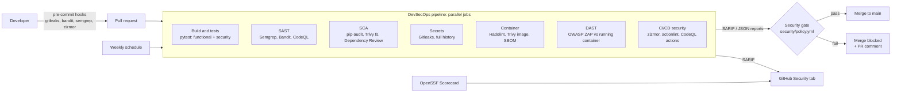

# SecureNotes: automated security auditing in a CI/CD pipeline

**Project 16: Ethical Hacking, Stage 4, Computer Science**

> Integrate automated Static Application Security Testing (SAST) and dependency
> vulnerability scanners into a GitHub Actions pipeline.

This repository contains:

1. **SecureNotes**, a small Flask web app (login, notes, search, file upload, YAML import) that the pipeline protects.
2. A **DevSecOps pipeline** in GitHub Actions that runs **13 security tools** on every pull request, every push to `main` and once a week.
3. A **security gate** written as policy-as-code. It reads every tool's report and decides whether the change may be merged.
4. A **`vulnerable` branch** with **23 planted, labelled vulnerabilities**. It proves the pipeline works and lets us measure how good each scanner is.

Our project goes further than the brief. Besides SAST and dependency scanning, we also run secret scanning, container scanning, DAST, CI/CD pipeline security checks, an SBOM, and a supply-chain hardened pipeline.

---

## Pipeline at a glance



| Stage | Tool | What it finds | OWASP Top 10:2025 |
|---|---|---|---|
| Tests | **pytest** (27 tests, 17 of them security regression tests) | Each fixed bug stays fixed | All |
| SAST | **Semgrep**: registry packs + 3 custom rules | Injection, XSS, insecure APIs, **IDOR** (custom rule) | A01, A05, A09 |
| SAST | **Bandit** | Python-specific: `shell=True`, MD5, `yaml.load`, SQL strings | A04, A05, A08 |
| SAST | **CodeQL** (`security-extended`) | Data-flow analysis from user input to dangerous sinks | A01, A05, A10 |
| SCA | **pip-audit** | Known CVEs in Python dependencies (PyPI/OSV database) | A03 |
| SCA | **Trivy** filesystem | CVEs, Dockerfile misconfigurations, secrets | A02, A03 |
| SCA | **Dependency Review** | Vulnerable or AGPL-licensed dependencies added by a PR | A03 |
| Secrets | **Gitleaks** | API keys and passwords in the **whole git history** | A07 |
| Container | **Hadolint** | Dockerfile bad practices | A02 |
| Container | **Trivy** image + **SBOM** | OS and library CVEs in the built image; CycloneDX bill of materials | A03 |
| DAST | **OWASP ZAP** | Runtime problems: missing headers, CSRF, cookies | A01, A02 |
| CI/CD | **zizmor**, **actionlint**, **CodeQL (actions)** | Insecure GitHub Actions workflows (script injection, unpinned actions) | A03 |
| Repo | **OpenSSF Scorecard**, **Dependabot**, **secret scanning + push protection** | Repository supply-chain posture, automatic update PRs, blocked pushes | A03, A07 |

The pipeline is described in detail in **[docs/PIPELINE.md](docs/PIPELINE.md)**.

---

## Repository layout

```
app/                     Flask application (hardened on main)
  routes.py              HTTP handlers, comments name the OWASP risk each control covers
  security.py            password hashing, CSRF, login, security headers
tests/                   functional tests + security regression tests
.github/workflows/
  devsecops.yml          the DevSecOps pipeline
  scorecard.yml          OpenSSF Scorecard
.github/dependabot.yml   automatic updates for pip, Docker and Actions pins
security/
  policy.yml             security gate policy: thresholds + accepted risks
  semgrep-rules/         our custom Semgrep rules
  ground-truth.yml       list of the planted vulnerabilities (for the benchmark)
  requirements-tools.txt hash-locked scanner versions
scripts/
  security_gate.py       pass/fail decision from all reports
  benchmark.py           detection matrix: which tool found which planted bug
  findings.py            parses SARIF / pip-audit / ZAP into one format
  setup_github.sh        one-command GitHub setup
docs/                    team guide, demo script, vulnerability catalogue, report template
Dockerfile               hardened image (non-root, digest-pinned, hash-locked)
```

## Branches

| Branch | Purpose | Pipeline result |
|---|---|---|
| `main` | Hardened application | ✅ security gate passes |
| `vulnerable` | Same app with 23 planted bugs, each marked `# VULN-xx` | ❌ security gate blocks the PR. **Never merge.** |

Run `git diff main vulnerable` to see every planted vulnerability next to its fix.

---

## Quick start (local)

Requirements: Python 3.12+, Docker, git.

```bash
make install        # .venv with hash-locked app, test and scanner dependencies
make test           # 27 tests, all pass on main
make run            # http://127.0.0.1:8000
make scan-bandit scan-deps scan-workflows   # run some scanners locally
make gate           # apply the security policy to reports/
```

To see the vulnerable version fail:

```bash
git checkout vulnerable
make test           # 16 security tests fail: every planted bug is caught by a test
git checkout main
```

## Setting up on GitHub (once, by one team member)

```bash
gh auth login
scripts/setup_github.sh securenotes-devsecops <teammate1> <teammate2>
```

This creates a public repository, pushes both branches, enables secret scanning, push protection, Dependabot and private vulnerability reporting, locks Actions down to SHA-pinned actions, protects `main` with a ruleset (PR + code-owner review + green **Security gate**) and opens the demo PR. Each step is explained in **[docs/SETUP-GITHUB.md](docs/SETUP-GITHUB.md)**.

## Documentation

| Document | For |
|---|---|
| [docs/TEAM-GUIDE.md](docs/TEAM-GUIDE.md) | Who does what in our team of 3, timeline, what each person must understand |
| [docs/PIPELINE.md](docs/PIPELINE.md) | How every job, tool and the security gate work, and why |
| [docs/VULNERABILITIES.md](docs/VULNERABILITIES.md) | The 23 planted bugs: vulnerable code, fix, which tool catches it |
| [docs/DEMO-SCRIPT.md](docs/DEMO-SCRIPT.md) | Step-by-step live demo for the presentation |
| [docs/SETUP-GITHUB.md](docs/SETUP-GITHUB.md) | Manual version of the setup script |
| [docs/THREAT-MODEL.md](docs/THREAT-MODEL.md) | STRIDE threat model of the app **and** of the pipeline |
| [docs/REPORT-TEMPLATE.md](docs/REPORT-TEMPLATE.md) | Structure for the written report, with what goes in each section |

## Ethics and scope

All testing in this project targets **our own application** in our own repository and CI runners. The `vulnerable` branch is teaching material: it is never deployed and never merged. The planted "secrets" are fake values. Do not point the DAST scanner at systems you do not own or have written permission to test.
